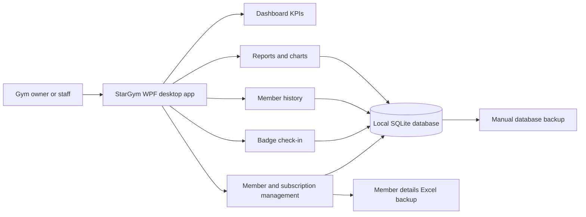
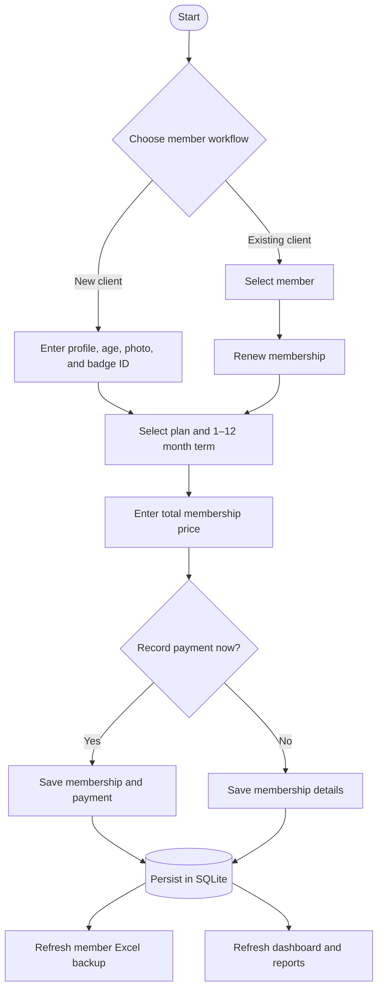

<div align="center">


# StarGym

**A focused desktop workspace for running the day-to-day operations of a gym.**

Member profiles · Memberships · Badge check-in · Attendance · Reports

</div>

---

## At a glance

StarGym is a Windows desktop application for gym owners and staff. It brings member registration, subscription renewals, badge-based entry, attendance history, operational KPIs, and reporting into one local app.

| | |
| --- | --- |
| **Platform** | Windows x64 |
| **Desktop UI** | WPF |
| **Runtime** | .NET 8, bundled in the self-contained release |
| **Local storage** | SQLite |
| **Solution** | `StarGymApp.sln` |

> **Designed for local use.** The database is stored on the computer running StarGym. The app does not currently synchronize member data between PCs.

## Product highlights

### Dashboard
- See total, active, and expired memberships, plus monthly revenue.
- Follow members currently in the gym, today's check-ins, and monthly attendance.
- Review the last seven days of attendance and the current floor-activity share.
- KPIs refresh during normal app use and after local check-in or membership changes.

### Member management
- Register clients with a profile photo, name, age, contact details, and badge ID.
- Search by member name, phone number, or badge ID; filter by membership status.
- Create a subscription with a manually entered total price and a term from 1 to 12 months.
- Renew a membership while retaining the member's existing profile.
- Edit or remove a client. Removing a client also removes their associated payment and attendance records.

### Badge check-in and member history
- Scan a member's badge or enter the badge ID into the check-in field.
- A recognized, eligible badge records attendance and updates member history.
- Member history places the newest check-in first and shows the member profile details.
- USB scanners that act as keyboards depend on the Windows keyboard layout. Configure the scanner's keyboard country/layout to match the PC.

### Reports and backups
- Review revenue and attendance summaries and revenue charts.
- StarGym maintains a member-details Excel workbook at:
  `Documents\StarGym Backups\StarGym-Member-Backup.xlsx`
- The workbook is refreshed at startup and after member creation, renewal, editing, or removal. It contains badge IDs and personal membership details, so store it securely.
- A separate database backup can be created from the Reports screen. Keep database backups in a safe location; the Excel workbook does not include full attendance/payment history or photos.

<div align="center">

</div>

## Getting started

### Run the packaged application

1. Download the Windows x64 ZIP from the project's GitHub Release (when one is published).
2. Extract the **entire ZIP** to a folder you can keep in place. Do not separate the executable from its `Data` folder.
3. Run `StarGymApp.Desktop.exe`.
4. Optional: run `Create Desktop Shortcut.bat` from the extracted folder to create a StarGym shortcut on the Windows Desktop.

The release is self-contained: .NET is included, so a separate .NET installation is not required. The shortcut points to the extracted executable, so do not move or delete the extracted folder afterward.

> **First launch / data reset:** The production setup includes a one-time reset that clears pre-existing StarGym member, payment, and attendance records, and stored member photos. It is intended to remove demo data before real use. It does not create a backup before clearing. Do not run this version against a database containing information you need to keep.

### Build from source

Requirements:
- Windows x64
- .NET 8 SDK
- Git (if cloning the repository)

```powershell
git clone <repository-url>
cd StarGym
dotnet restore StarGymApp.sln
dotnet build StarGymApp.sln --configuration Release
dotnet test tests\StarGymApp.Core.Tests\StarGymApp.Core.Tests.csproj --configuration Release
```

Run the desktop project:

```powershell
dotnet run --project src\StarGymApp.Desktop\StarGymApp.Desktop.csproj
```

### Publish a self-contained Windows release

```powershell
dotnet publish src\StarGymApp.Desktop\StarGymApp.Desktop.csproj `
  --configuration Release `
  --runtime win-x64 `
  --self-contained true `
  -p:PublishSingleFile=true `
  -p:IncludeNativeLibrariesForSelfExtract=true `
  -p:IncludeAllContentForSelfExtract=false `
  -p:DebugType=None `
  -p:DebugSymbols=false `
  -o .\publish\StarGym-win-x64
```

Zip the **contents** of `publish\StarGym-win-x64` for distribution. Include the executable, `Data` folder, and `Create Desktop Shortcut.bat` if available.

## How the application fits together



### New member and renewal workflow



## Data and privacy

- The operational database is stored locally at `%LOCALAPPDATA%\StarGym\stargym.db`.
- Member photos are stored under `%LOCALAPPDATA%\StarGym\Images\Members`.
- The member Excel backup is stored under the current user's Documents folder in `StarGym Backups`.
- Badge IDs, ages, contact information, and subscription details are personal information. Restrict access to the computer, database, backups, and Excel workbook.
- Copy the SQLite database backup to a separate, secure location. A backup stored only on the same computer may be lost if that computer fails.
- StarGym currently provides local storage, not cloud sync, user accounts, or multi-PC coordination.

## Repository layout

```text
StarGym/
├── src/
│   ├── StarGymApp.Core/          # Models, SQLite repositories, and services
│   └── StarGymApp.Desktop/       # WPF screens, app startup, and assets
├── tests/
│   └── StarGymApp.Core.Tests/    # Core unit and repository tests
├── docs/                         # Supporting project documentation
└── StarGymApp.sln
```

## Verification

Run the core tests with:

```powershell
dotnet test tests\StarGymApp.Core.Tests\StarGymApp.Core.Tests.csproj
```

The test suite covers core subscription and reporting behavior, SQLite persistence, Excel backup generation, and one-time production reset behavior. Hardware-specific camera and badge-scanner operation should also be checked on the target PC.

## Support and contributions

For a bug report, include:
- What you were doing
- What you expected
- What happened instead
- Your Windows version and whether you used the packaged release or a source build

Do not attach real member data, the SQLite database, photos, or the Excel backup to a public issue.

---

<div align="center">

**StarGym — Stronger people build a healthier community.**

</div>
